# Qwen-Image-2.1-Turbo-NVFP4-8GB-Fast

在 **RTX 5060 Laptop (8GB VRAM)**（通用 RTX 50 系 Blackwell 显卡：`RTX 5060 / 5060 Ti / 5070 / 5080 / 5090`）上运行 **ComfyUI `Qwen-Image 2.1 Turbo` (NVFP4)** 的推理加速补丁、工作流配置与多精度实测对比报告（实测纯 NVFP4：`1K 4.1s~5.3s` / `1.5K 9.0s` / `2K 23.7s~26.7s`）。

---

## 1. 硬件与模型配置参数

### 硬件与软件环境
- **GPU**: NVIDIA GeForce RTX 5060 Laptop GPU (8151 MB VRAM)
- **OS**: Windows 11
- **Python / PyTorch**: Python 3.13.11 / PyTorch 2.9.1+cu130
- **ComfyUI**: v0.37.1（启用 `comfy-kitchen` 与 `comfy_aimdo` 动态显存管理）

### 使用的模型文件
- **扩散模型 (`diffusion_models`)**：
  - 纯 NVFP4（速度快 15%~20%，显存占用更低）：`qwen-image-2.1-turbo-NVFP4.safetensors` (`4.00 GB`)
  - 混合精度 NVFP4（极小字笔画略稳）：`qwen_image_2.1_turbo_nvfp4_mixed.safetensors` (`5.43 GB`)
- **文本编码器 (`text_encoders`)**: `qwen3vl_8b_w4a8_lmhead4bit.safetensors`
- **VAE (`vae`)**: `qwen_image_2.1_vae_bf16.safetensors`
- **采样参数**: `euler` + `simple`，`CFG = 1.0`，`4 / 6 / 8` 步

---

## 2. 我们做了什么

1. **启用 Comfy Kitchen INT8 注意力与 Prefix KV 缓存**
   - 在工作流子图中接入 `ModelAttentionBackend`（选择 `comfy kitchen attention`）与 `QwenImage21Cache`（`device=auto`, `dtype=int8`），缓存文本与参考图的前缀 KV，减少每步重复计算。

2. **分分辨率调整 Sigma 调度曲线，并支持 4/6/8 步动态重采样**
   - `ComfyUI/comfy_extras/nodes_custom_sampler.py` & `nodes_resolution.py`：
   - 针对 1K 分辨率调整了 6 步 Sigma 曲线（`1.0, 0.934262, 0.848546, 0.741433, 0.584844, 0.328448, 0.0`），降低小字漏笔率；1.3K / 1.5K / 2K 保持标准蒸馏曲线（`1.0, 0.972236, 0.937186, 0.89508, 0.805499, 0.514892, 0.0`）。
   - 为 `ManualSigmas` 增加 `steps` 输入并连接外层面板步数，修改外层 `steps`（如改为 4 步）时自动在当前曲线上插值重采样。
   - 修改 `ResolutionSelector` 节点，提供 1K / 1.3K / 1.5K / 2K 原生 16 对齐尺寸预设，并自动输出 `use_2k_sigmas` 布尔信号切换调度曲线。

3. **复用已加载的 `Qwen3-VL-8B` 做提示词扩写补字 (`prompt_enhance` 开关)**
   - `ComfyUI/comfy_extras/nodes_qwen.py` (`TextEncodeQwenImage21`)：
   - 在 `CFG=1.0` 的蒸馏模型中，如果提示词包含科普卡、招牌、分镜、包装等载体但未写出具体文字，画面容易生成伪文字乱码。
   - 我们在 `TextEncodeQwenImage21` 内部直接调用已加载的 `qwen3vl_8b_w4a8_lmhead4bit`（利用其自带的 4-bit `lm_head`）在编码前生成具体文字描述并用双引号标出，无需额外加载第二个 LLM 模型，不增加额外显存峰值。作为布尔开关放在工作流外层节点上，可按需开启或关闭。

4. **内置首块残差跳步缓存 (`fbcache` 开关)**
   - `ComfyUI/comfy/ldm/qwen_image21/model.py` & `ComfyUI/comfy_extras/nodes_qwen.py` (`QwenImage21Cache`)：
   - 在 `QwenImage21Transformer2DModel._forward` 内部增加了可选的 First-Block Residual Cache（避免使用 `patches_replace` 导致 `QwenImage21Cache` 失效）。
   - 仅在高噪期（`t > 0.91`）记录残差，2K 分辨率下将基线卸载至内存，并在跳步完成后立即释放张量，避免占用 `WanVAE` 解码显存。同样作为外层开关提供（默认关闭）。

5. **修复 RTX 50 系显卡 `Fault failed: 2` 报错**
   - `ComfyUI/comfy/model_patcher.py`、`ComfyUI/comfy/model_management.py`、`python/Lib/site-packages/comfy_aimdo/model_vbar.py`：
   - 在 `vbar.prioritize()` 前及 `vbar_fault` 异常分支增加 CUDA 流同步与重试，解决连续生成时偶发的 `RuntimeError: Fault failed: 2`（`cuMemSetAccess: device not ready`）。

---

## 3. 实测基准数据与样张对比

> **测试方法**：每次切换模型或切换分辨率档位先执行 **1 次预热 (Warm-up)**；稳态测速采用 **`seed = 42, 43, 44` 连续运行 3 次取平均值 (Mean) ± 标准差 (Std)**；通过 Windows 原生 `nvml.dll` 与 `psutil` 每 `50ms` 采样记录 **GPU 物理显存峰值 (`VRAM Peak`)** 与 **ComfyUI 进程独占内存峰值 (`Proc RAM Peak`)**；所有画质对比图统一固定 **`seed = 42`**。完整 72 张测试样张与原始数据见 [`benchmark_output/BENCHMARK_REPORT.md`](benchmark_output/BENCHMARK_REPORT.md)。

### 3.1 模型精度 × 全分辨率 × 步数 耗时与显存/内存峰值表 (`3:4` 数学高考试卷)

| 分辨率 (`3:4`) | 步数 | 混合 NVFP4 (`5.4GB`) | 纯 NVFP4 (`4.0GB`) | 纯 NVFP4 提速 | 混合 NVFP4 显存 / 进程内存峰值 | 纯 NVFP4 显存 / 进程内存峰值 | 样张对比 (`seed=42`) |
| :--- | :---: | :--- | :--- | :--- | :--- | :--- | :--- |
| **1K** (`896×1200`) | `4` | **4.99s** ± 0.04s | **4.10s** ± 0.07s | **-0.89s (-17.8%)** | 7479 MB / 5.19 GB | **6797 MB / 4.50 GB** | [混合](benchmark_output/images/Part1_P1_Exam_3x4_1K_4step_mixedNVFP4.webp) / [纯NVFP4](benchmark_output/images/Part1_P1_Exam_3x4_1K_4step_pureNVFP4.webp) |
| **1K** (`896×1200`) | `6` | **6.58s** ± 0.17s | **5.33s** ± 0.05s | **-1.25s (-19.0%)** | 7287 MB / 5.20 GB | **6797 MB / 4.49 GB** | [混合](benchmark_output/images/Part1_P1_Exam_3x4_1K_6step_mixedNVFP4.webp) / [纯NVFP4](benchmark_output/images/Part1_P1_Exam_3x4_1K_6step_pureNVFP4.webp) |
| **1K** (`896×1200`) | `8` | **8.23s** ± 0.01s | **6.54s** ± 0.05s | **-1.69s (-20.5%)** | 7319 MB / 5.20 GB | **6797 MB / 4.50 GB** | [混合](benchmark_output/images/Part1_P1_Exam_3x4_1K_8step_mixedNVFP4.webp) / [纯NVFP4](benchmark_output/images/Part1_P1_Exam_3x4_1K_8step_pureNVFP4.webp) |
| **1.3K** (`1152×1536`) | `4` | **7.78s** ± 0.07s | **6.35s** ± 0.06s | **-1.42s (-18.3%)** | 7479 MB / 5.51 GB | **7277 MB / 4.53 GB** | [混合](benchmark_output/images/Part1_P1_Exam_3x4_1.3K_4step_mixedNVFP4.webp) / [纯NVFP4](benchmark_output/images/Part1_P1_Exam_3x4_1.3K_4step_pureNVFP4.webp) |
| **1.3K** (`1152×1536`) | `6` | **10.42s** ± 0.06s | **8.42s** ± 0.05s | **-2.00s (-19.2%)** | 7415 MB / 5.51 GB | **7373 MB / 4.53 GB** | [混合](benchmark_output/images/Part1_P1_Exam_3x4_1.3K_6step_mixedNVFP4.webp) / [纯NVFP4](benchmark_output/images/Part1_P1_Exam_3x4_1.3K_6step_pureNVFP4.webp) |
| **1.3K** (`1152×1536`) | `8` | **13.05s** ± 0.09s | **10.45s** ± 0.02s | **-2.61s (-20.0%)** | 7607 MB / 5.51 GB | **7277 MB / 4.53 GB** | [混合](benchmark_output/images/Part1_P1_Exam_3x4_1.3K_8step_mixedNVFP4.webp) / [纯NVFP4](benchmark_output/images/Part1_P1_Exam_3x4_1.3K_8step_pureNVFP4.webp) |
| **1.5K** (`1344×1792`) | `4` | **8.27s** ± 0.23s | **6.77s** ± 0.07s | **-1.50s (-18.2%)** | 7543 MB / 5.89 GB | **7021 MB / 4.55 GB** | [混合](benchmark_output/images/Part1_P1_Exam_3x4_1.5K_4step_mixedNVFP4.webp) / [纯NVFP4](benchmark_output/images/Part1_P1_Exam_3x4_1.5K_4step_pureNVFP4.webp) |
| **1.5K** (`1344×1792`) | `6` | **11.23s** ± 0.01s | **9.02s** ± 0.11s | **-2.21s (-19.7%)** | 7415 MB / 5.89 GB | **7021 MB / 4.55 GB** | [混合](benchmark_output/images/Part1_P1_Exam_3x4_1.5K_6step_mixedNVFP4.webp) / [纯NVFP4](benchmark_output/images/Part1_P1_Exam_3x4_1.5K_6step_pureNVFP4.webp) |
| **1.5K** (`1344×1792`) | `8` | **14.11s** ± 0.04s | **11.33s** ± 0.01s | **-2.78s (-19.7%)** | 7447 MB / 5.89 GB | **7021 MB / 4.55 GB** | [混合](benchmark_output/images/Part1_P1_Exam_3x4_1.5K_8step_mixedNVFP4.webp) / [纯NVFP4](benchmark_output/images/Part1_P1_Exam_3x4_1.5K_8step_pureNVFP4.webp) |
| **2K** (`1776×2368`) | `4` | **22.86s** ± 0.10s | **19.65s** ± 0.09s | **-3.21s (-14.0%)** | 8055 MB / 9.13 GB | **7501 MB / 7.42 GB** | [混合](benchmark_output/images/Part1_P1_Exam_3x4_2K_4step_mixedNVFP4.webp) / [纯NVFP4](benchmark_output/images/Part1_P1_Exam_3x4_2K_4step_pureNVFP4.webp) |
| **2K** (`1776×2368`) | `6` | **31.52s** ± 0.17s | **26.73s** ± 0.20s | **-4.79s (-15.2%)** | 7991 MB / 9.13 GB | **7341 MB / 7.53 GB** | [混合](benchmark_output/images/Part1_P1_Exam_3x4_2K_6step_mixedNVFP4.webp) / [纯NVFP4](benchmark_output/images/Part1_P1_Exam_3x4_2K_6step_pureNVFP4.webp) |
| **2K** (`1776×2368`) | `8` | **40.28s** ± 0.13s | **34.05s** ± 0.04s | **-6.23s (-15.5%)** | 8055 MB / 9.29 GB | **7341 MB / 7.53 GB** | [混合](benchmark_output/images/Part1_P1_Exam_3x4_2K_8step_mixedNVFP4.webp) / [纯NVFP4](benchmark_output/images/Part1_P1_Exam_3x4_2K_8step_pureNVFP4.webp) |

---

### 3.2 官方原版满血精度 vs 本地混合 NVFP4 vs 本地纯 NVFP4 同屏对比 (`seed=42`)

> **说明**：以下 6 组提示词均取自 Qwen-Image-2.1 官方示例库，官方原版参考图同样在 `seed = 42` 下由云端满血模型生成，可直接与本地 RTX 5060 Laptop (8GB) 6 步量化生成的样张做同源对比。

#### (1) P1：2026 数学高考试卷（`3:4` · 密集中文印刷体 + 数学公式符号）
> 三者在卷面布局、左侧装订密封虚线、大标题、正楷体注意事项、宋体试题与右侧 $\triangle ABC$ 几何图上高度一致。值得注意的是，官方原版参考图在第 15 题公式中出现了 `coosA` 的拼写瑕疵，而本地混合 NVFP4 与纯 NVFP4 在 `2K 6步` 下均准确输出了 `acosC + ccosA = bsinB`。

| 官方原版满血参考图 (`seed=42`) | 本地混合 NVFP4 (`2K 6步` \| `31.52s` \| VRAM `7991MB`) | 本地纯 NVFP4 (`2K 6步` \| `26.73s` \| VRAM `7341MB`) |
| :---: | :---: | :---: |
| 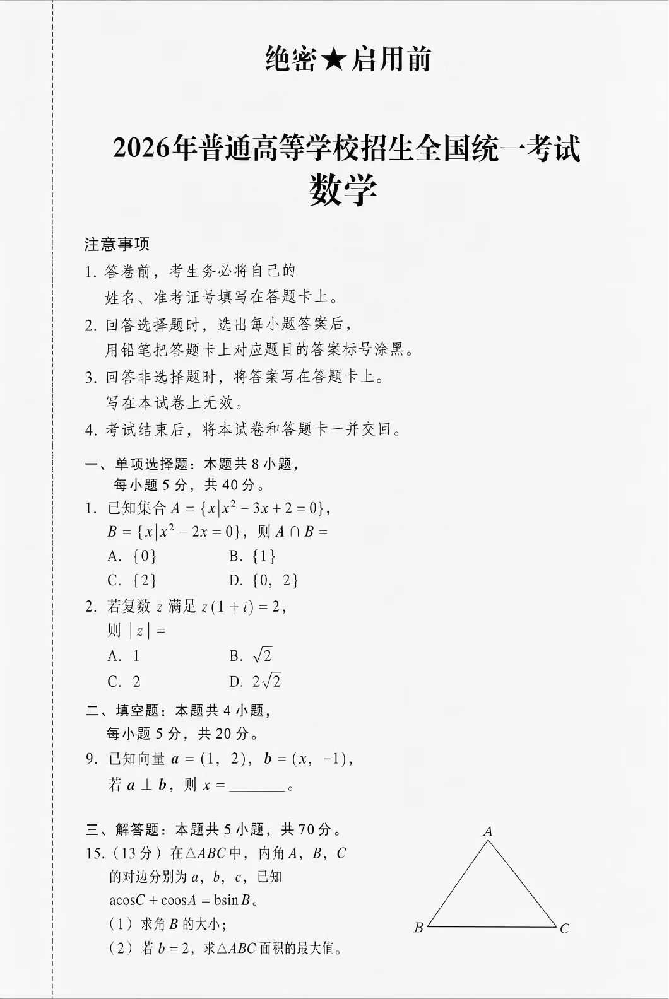 | 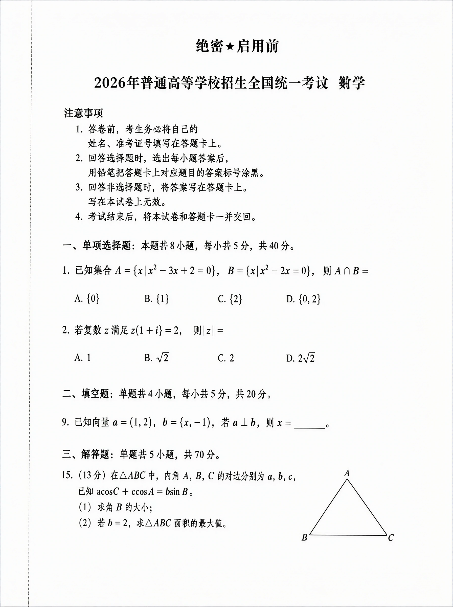 | 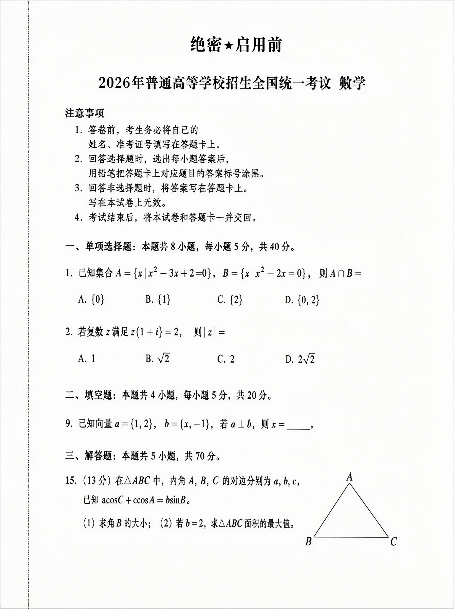 |

#### (2) P2：奥拉维城堡建筑讲解图板（精细建筑测绘线稿 + 多分区微缩小字）
> 主标题、俯视透视城堡插画、南立面图 `1:200`、局部放大详图 `1:20`、入口人流分析、材料图例与构造剖面示意 `1:100` 等模块完整还原。在极微缩小字号下，官方原版满血精度笔画最锐利；本地混合精度次之（如主桥下方的 `① 主入口` 保持清晰），纯 NVFP4 速度最快（快 `4.78s`、进程内存省 `1.95 GB`），仅在极小字号下有轻微笔画粘连。

| 官方原版满血参考图 (`seed=42`) | 本地混合 NVFP4 (`2K 6步` \| `31.77s` \| RAM `9.65GB`) | 本地纯 NVFP4 (`2K 6步` \| `26.99s` \| RAM `7.70GB`) |
| :---: | :---: | :---: |
| 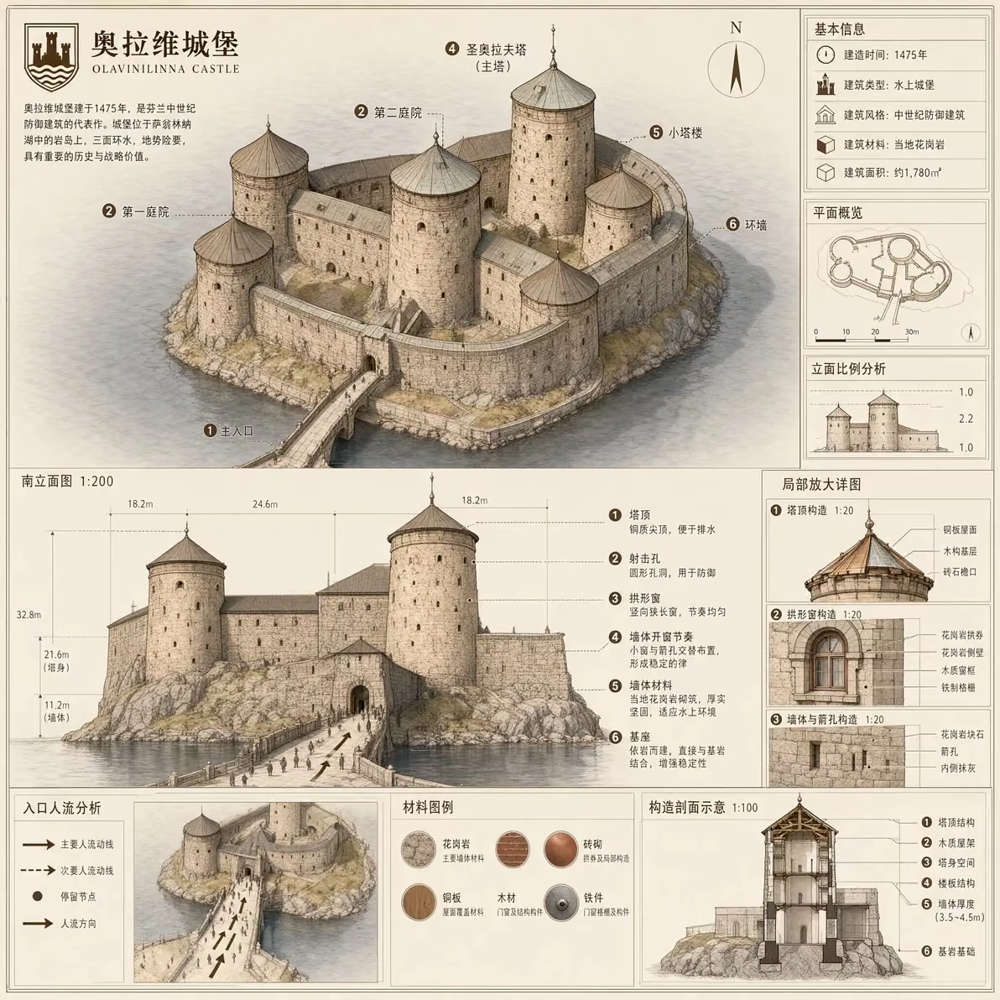 | 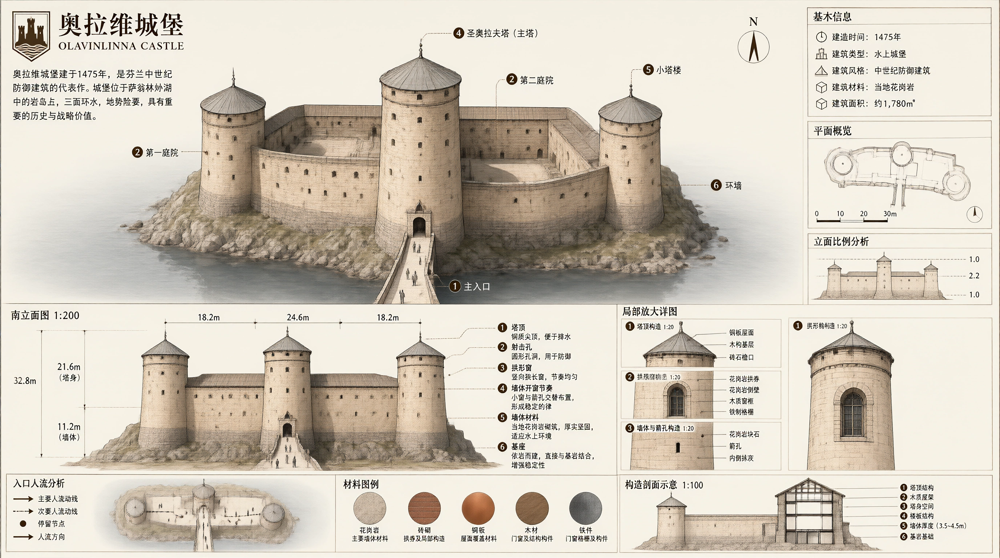 | 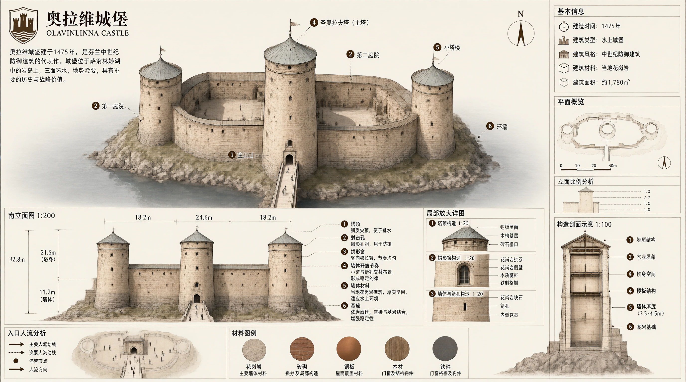 |

#### (3) P3：Wanderlust 旅行规划 App 界面（`9:16` · 现代 UI 卡片、图标与英文小字）
> 状态栏（`9:41` / `85%`）、顶部头像栏（`Good morning, Sarah`）、圣托里尼主视觉卡片、四个功能图标（`Flights` / `Hotels` / `Activities` / `Transfers`）、推荐列表（`Paris $450` / `Rome $520` / `Zermatt $600`）、历史行程卡片及底部导航栏，本地纯 NVFP4 / 混合 NVFP4 与官方原版几乎无肉眼差异。

| 官方原版满血参考图 (`seed=42`) | 本地混合 NVFP4 (`2K 6步` \| `30.89s` \| VRAM `7479MB`) | 本地纯 NVFP4 (`2K 6步` \| `26.20s` \| VRAM `6797MB`) |
| :---: | :---: | :---: |
|  |  |  |

#### (4) P4：动漫婚纱角色立绘（`3:4` · 无字纯画质、薄纱层次与光影）
> 在无文字纯画质场景下，本地 4-bit 量化（混合 NVFP4 与纯 NVFP4）在人物五官、金发光泽、银色皇冠、多层粉白渐变荷叶边裙摆、白玫瑰捧花与薄纱长袜细节上与官方原版基本持平。

| 官方原版满血参考图 (`seed=42`) | 本地混合 NVFP4 (`2K 6步` \| `31.66s` \| VRAM `8035MB`) | 本地纯 NVFP4 (`2K 6步` \| `26.80s` \| VRAM `7365MB`) |
| :---: | :---: | :---: |
|  |  |  |

#### (5) P6：巨兽对决 3DCG 故事板（`1:1` · 多格分镜与冰火特效）
> 官方参考图开启了云端智能改写（生成 4 宫格对决）；本地在未开启扩写（`prompt_enhance=False`）直跑原始大纲时，混合 NVFP4 与纯 NVFP4 均生成了完整的 5 格分镜（炎狱巨蜥喷火 vs 霜牙巨象喷寒气，中间废墟人类蜷缩避险）。

| 官方原版参考图 (云端智能改写开) | 本地混合 NVFP4 (`2K 6步` \| `31.19s` \| 原始提示词) | 本地纯 NVFP4 (`2K 6步` \| `26.47s` \| 原始提示词) |
| :---: | :---: | :---: |
|  | 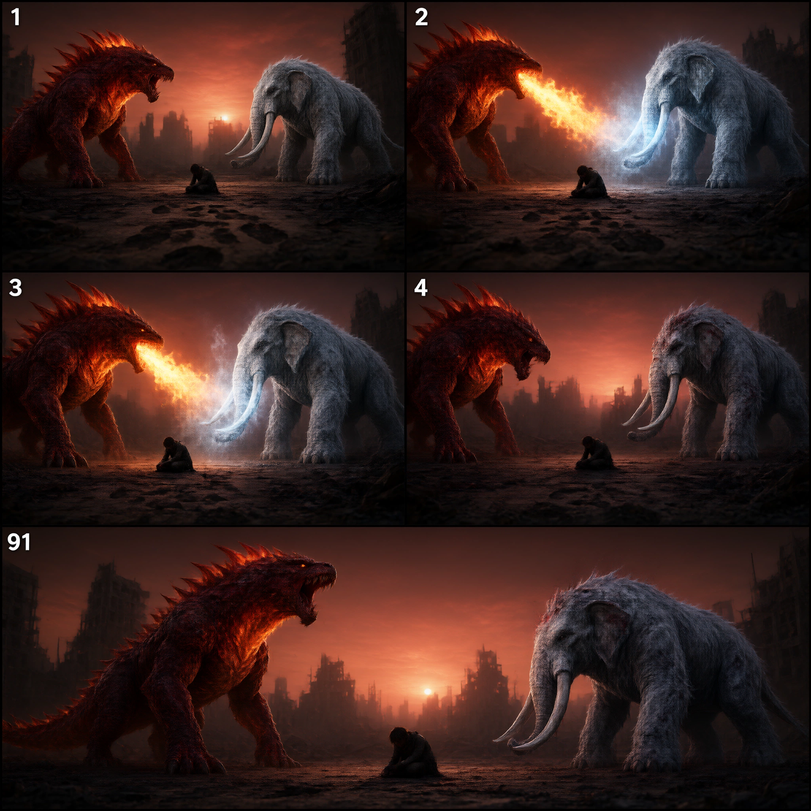 | 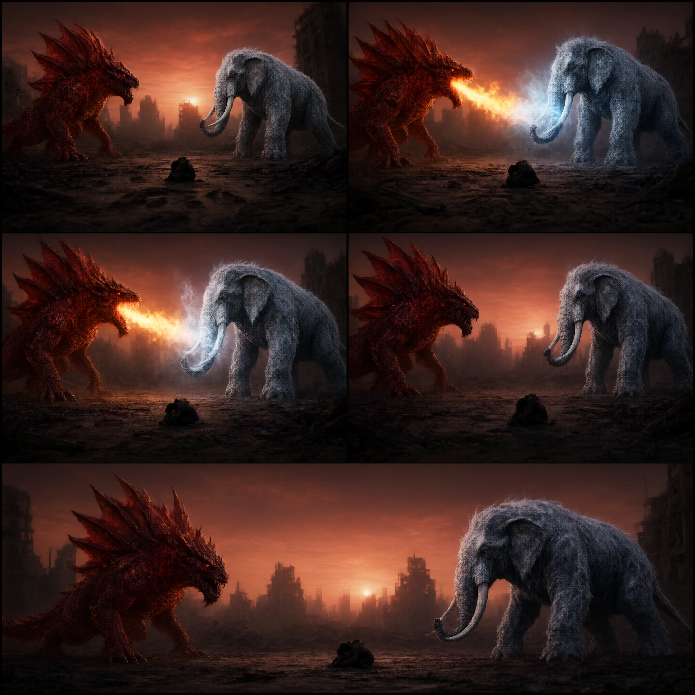 |

---

### 3.3 分辨率与步数梯度对比（纯 NVFP4，`seed=42`）

#### (1) 不同分辨率对比（`1K 6步` vs `1.5K 6步` vs `2K 6步`）
> 在 Turbo 模型下，提升分辨率对小字清晰度的改善远大于单纯增加步数。纯 NVFP4 跑 `1.5K 6步` 仅需 `9.02s`，正文字迹已接近 `2K`。

| 纯 NVFP4 · `1K 6步` (`5.33s`) | 纯 NVFP4 · `1.5K 6步` (`9.02s`) | 纯 NVFP4 · `2K 6步` (`26.73s`) |
| :---: | :---: | :---: |
| 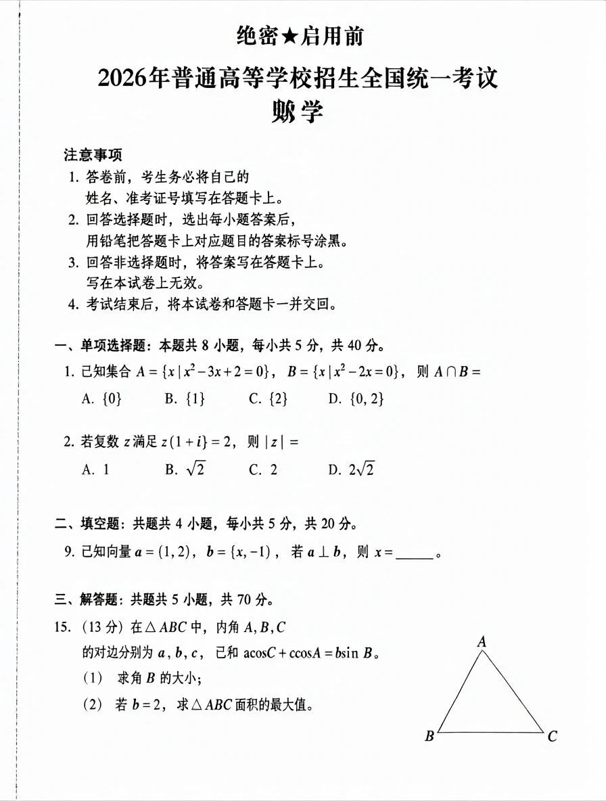 | 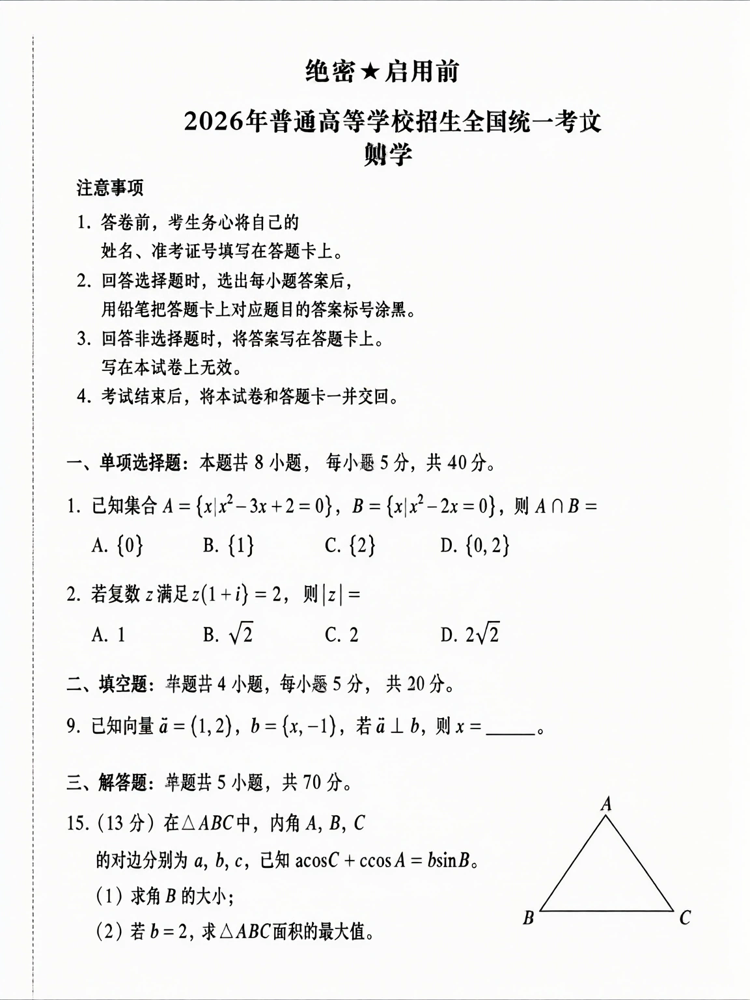 |  |

#### (2) 不同步数对比（`4` 步 vs `6` 步 vs `8` 步，`1K`）

| `4` 步 (`4.10s`) — 大字可用，小字与选项粘连 | `6` 步 (`5.33s`) — 文字笔画基本收敛（推荐） | `8` 步 (`6.54s`) — 相比 6 步改善有限 |
| :---: | :---: | :---: |
| 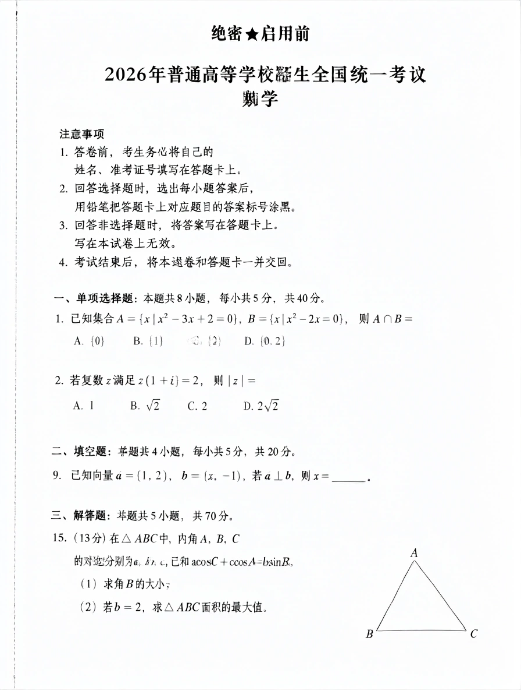 |  | 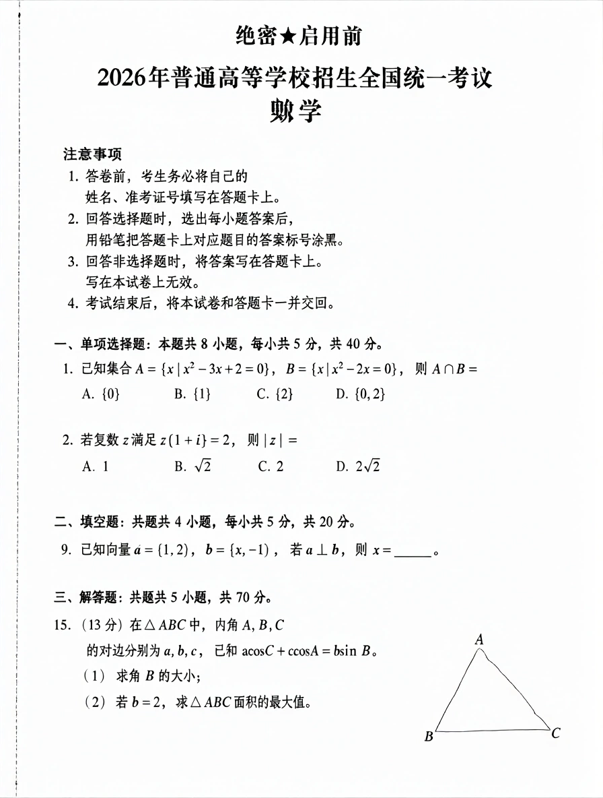 |

---

### 3.4 外层开关对比（`prompt_enhance` 扩写补字 & `fbcache` 缓存加速）

#### (1) `prompt_enhance` 开关：对比官方云端扩写 vs 本地关闭扩写 vs 本地开启扩写（P5 祈年殿拆解科普卡，`3:4`）
> 原始提示词仅 64 字（*“竖版祈年殿拆解科普卡……右侧虚线序号标注名称……”*），未指定右侧引线的具体文字内容。官方参考图依赖云端 `Prompt Extend` 补全了构件说明；本地关闭扩写时右侧引线全部为伪文字乱码；开启本地 `prompt_enhance = True`（复用已加载的 `Qwen3-VL-8B` 4-bit）后，耗时增加 `4.81s`，显存峰值几乎不变（`7526MB -> 7568MB`），右侧引线自动补全为清晰汉字（“柱础、檐角、斗拱、椽子、瓦当、脊兽”）。

| 官方原版参考图 (云端 `Prompt Extend` 开) | 本地纯 NVFP4 · `prompt_enhance = False` (`10.63s` \| 伪文字乱码) | 本地纯 NVFP4 · `prompt_enhance = True` (`15.44s` \| 自动补全构件名) |
| :---: | :---: | :---: |
| 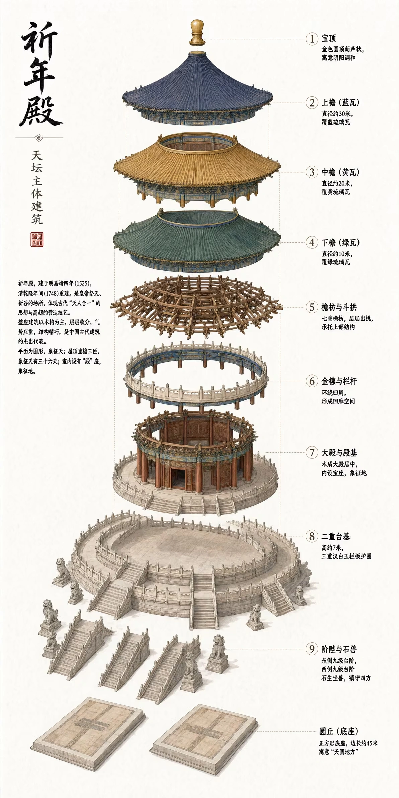 | 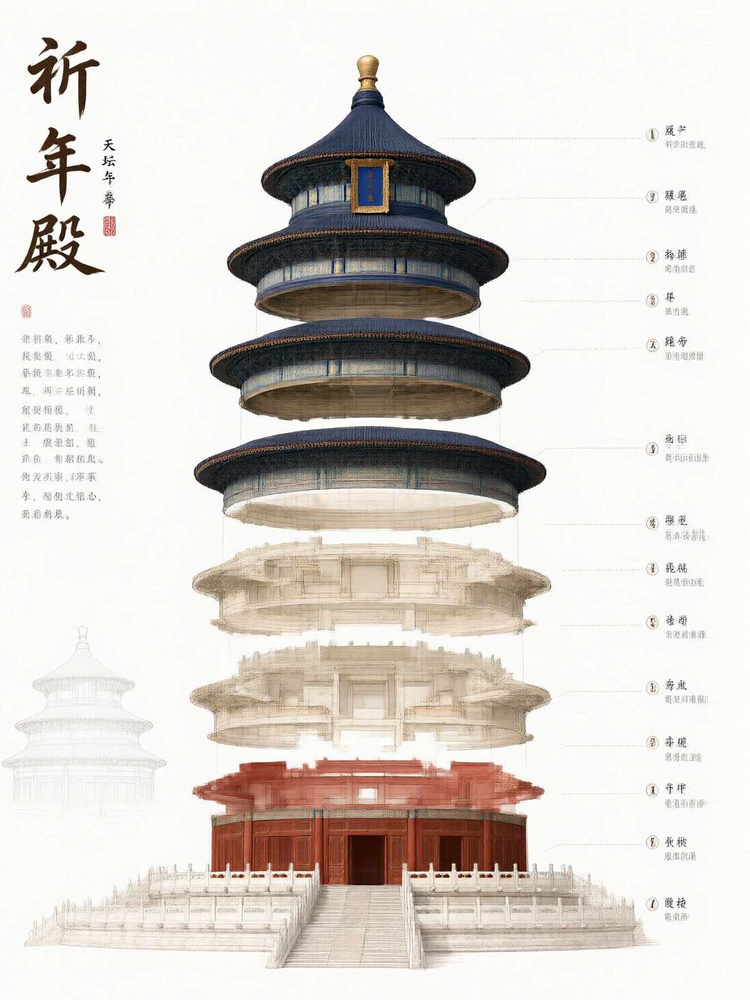 | 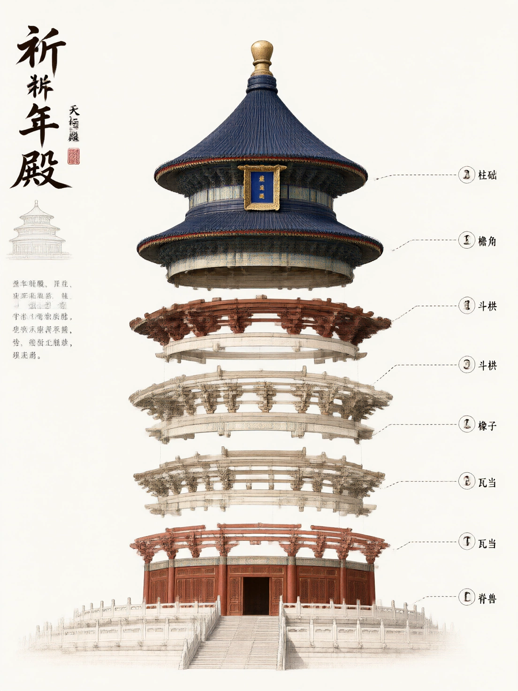 |

#### (2) `fbcache` 开关：2K 6 步一阶特征残差缓存对比（纯 NVFP4）

| 测试场景 | `fbcache = False` | `fbcache = True` | 耗时与显存变化 | 样张对比 |
| :--- | :--- | :--- | :--- | :--- |
| **P1 数学高考试卷 (`2K 3:4`, 6步)** | **33.48s** (8055 MB) | **23.76s** (7575 MB) | **-9.72s (-29.0%)**，显存降 480 MB | [关闭](benchmark_output/images/Part3_P1_Exam_3x4_2K_6step_FBCache_Off_pureNVFP4.webp) / [开启](benchmark_output/images/Part3_P1_Exam_3x4_2K_6step_FBCache_On_pureNVFP4.webp) |
| **P2 城堡建筑图板 (`2K 16:9`, 6步)** | **30.02s** (7952 MB) | **23.73s** (7191 MB) | **-6.29s (-21.0%)**，显存降 761 MB | [关闭](benchmark_output/images/Part3_P2_Castle_16x9_2K_6step_FBCache_Off_pureNVFP4.webp) / [开启](benchmark_output/images/Part3_P2_Castle_16x9_2K_6step_FBCache_On_pureNVFP4.webp) |

---

### 3.6 实测参数选型建议

1. **日常无字图 / 大标题海报 / 快速预览**：使用 **纯 NVFP4 + `1K` + `4` 步（`4.1s`）或 `6` 步（`5.3s`）**，关闭 `prompt_enhance` 与 `fbcache`。
2. **带中号/小号文字的卡片、UI、分镜（综合性价比最高）**：使用 **纯 NVFP4 + `1.3K`（`8.4s`）或 `1.5K`（`9.0s`）+ `6` 步**；若提示词较简略、未写明具体文字内容，开启 `prompt_enhance = True`。
3. **高密度试卷 / 学术信息图 / 建筑展板**：使用 **`2K` + `6` 步**（纯 NVFP4 约 `26.7s`；若追求极小字号的最高笔画稳定性，可切回混合精度 NVFP4 约 `31.5s`）。

---

## 4. 安装与回滚方法

### 方式一：让 AI 智能体按说明自动部署
将本目录交给你的 AI 编程助手，让其阅读 [`AGENT_GUIDE.md`](AGENT_GUIDE.md) 并执行部署与校验。

### 方式二：命令行脚本安装
```bash
# 检查将要修改的文件
python apply_patch_bundle.py --root "你的ComfyUI整合包根目录" --check

# 自动备份原文件为 .orig_backup 并覆盖安装
python apply_patch_bundle.py --root "你的ComfyUI整合包根目录" --apply

# 恢复原始备份文件
python apply_patch_bundle.py --root "你的ComfyUI整合包根目录" --rollback
```

## License
[MIT](LICENSE)
